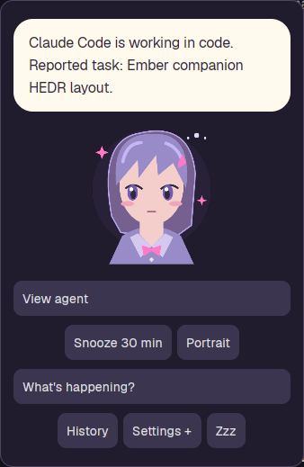

# Ember Companion

A second Violet Ember layout with a floating companion. Ember watches your
agents and tells you when one is working, finishes or needs you. The idea of a
character offering encouragement comes from
[VS Code Cheerleader](https://marketplace.visualstudio.com/items?itemName=cheerleader.cheerleader).
The original Violet Ember layout remains available.



*Captured in Herdr desktop with the animated vector character.*

## What you get

- **Floating companion.** Ember sits in a draggable floating block over the
  terminal area. She shows speech bubbles for agent updates and changes
  expression with each agent's status.
- **Two characters.** Choose an illustrated chibi (the default) or an animated
  vector character that blinks, thinks, worries, celebrates and sleeps. Motion
  can be turned off.
- **What's happening?** Shows agent counts and tasks. Click a live agent to
  focus it.
- **History.** A timestamped log of the latest 60 status changes, kept across
  layout reloads.
- **Tasks sidebar tab.** Lists agents with the same task labels Ember uses.
  The **Agents** tab keeps Herdr's original list, with pinning and nested agents.
- **Interruption controls.** Follow all spaces or only the current one. Toggle
  work updates and completion alerts separately, use Quiet mode, or snooze
  alerts for 30 minutes. Blocked agents always take priority.
- **Compact portrait.** A small badge that counts blocked and finished agents.
- **25-minute focus timer**, encouragement and coffee breaks, in English or
  Portuguese.

Everything is local. Messages come from a fixed phrase set, not AI chat. Ember
reads only the agent metadata Herdr exposes, never terminal contents. The mods
make no network requests, run no external programs and write no files outside
Herdr's shared state. See the [mod README](mods/ember-companion/README.md) for
full behavior details.

## Install

Requires Herdr desktop (`herdr-app`) with its shipped `workspace-chrome`,
`spaces`, `agents`, `tabs`, `pane`, `files`, `changes` and `workspace-status`
mods. From this repository:

```sh
H="${HERDR_APP_HOME:-$HOME/.config/herdr-app}"
mkdir -p "$H/layouts" "$H/themes" "$H/mods"
cp layouts/ember-companion.json layouts/ember-companion.svg "$H/layouts/"
cp themes/violet-ember.json "$H/themes/"
cp -r mods/ember-companion mods/ember-agent-tabs "$H/mods/"
herdr-app check "$H/mods/ember-companion"
herdr-app check "$H/mods/ember-agent-tabs"
herdr-app do layout.switch '{"name":"ember-companion"}'
```

Review any same-named files in your Herdr home before copying over them. Both
mods use `place: none`, so they add nothing to your other layouts. To switch
back, run `herdr-app do layout.switch '{"name":"violet-ember"}'` or pick
another layout in Settings.

On first launch, a short setup asks for language and character and shows a
sample alert. You can reopen it from Ember's settings.

## Files

| Path | Purpose |
| --- | --- |
| `layouts/ember-companion.json` | Layout: sidebar with Tasks/Agents tabs, work area, floating companion |
| `mods/ember-companion/` | The companion: view (`main.js`), activity model, phrases, animation, artwork |
| `mods/ember-agent-tabs/` | The Tasks/Agents tab header for the sidebar |
| `tests/ember-*.cjs` | Behavior, animation and layout tests (Node, no dependencies) |
| `tools/generate-ember-animation.py` | Regenerates the 15 vector animation frames from `ember.svg` |

## Development

From the repository root:

```sh
node tests/ember-companion.cjs
node tests/ember-animation.cjs
node tests/ember-layout.cjs
python3 tools/generate-ember-animation.py
```

The tests check behavior against Herdr's `gpui-kit.d.ts`. That file ships with
Herdr and isn't in this repository. The tests look for it in
`$HERDR_APP_HOME` or `~/.config/herdr-app`, or at the path in `GPUI_KIT_TYPES`.

## Verification

Checked on 2026-11-17 in Herdr desktop on Linux:

- All three test files pass. The generator reproduces the shipped frames exactly.
- `herdr-app check` passes for `ember-companion` and `ember-agent-tabs`.
- Switching to the layout reports no Herdr errors. The floating companion
  rendered with a live agent bubble, its character and controls.
- The Tasks tab listed live agents by status. Selecting the Agents tab showed
  Herdr's original agent list.

Not yet exercised in the live app: clicking each companion button (View agent,
snooze, history, settings, focus timer, sleep), dragging, first-run setup, the
Portuguese text and the compact portrait. The automated tests cover their logic
but not native clicks.

## Credits

The layout derives from the Violet Ember layout and Herdr's Apache-2.0 main
layout (see `LICENSE-HERDR`). Ember's PNG artwork is original and AI-generated,
and the vector character is hand-written SVG. See
[ARTWORK.md](mods/ember-companion/ARTWORK.md) and
[EXPRESSIONS.md](mods/ember-companion/EXPRESSIONS.md). No Cheerleader code or
character assets are used, and Ember is not a Live2D model.
