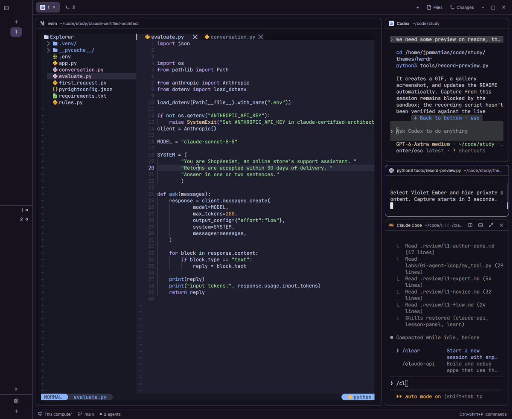

# Violet Ember for Herdr desktop

A dark violet theme with coral errors, readable terminal colors, purple
navigation accents, pink primary buttons and green success indicators.
Selected rows and terminal selections use a stronger purple than hover states.
Secondary text and borders are brighter for readability.



*Recorded in Herdr desktop.*

Foreground, muted, dim and accent text were checked against every configured UI
surface: all exceed 4.5:1 contrast. Primary button text also exceeds 4.5:1.
ANSI red exceeds 5.8:1 on the terminal background. Terminal applications can
choose other foreground/background combinations; these checks do not cover them.

This JSON targets **Herdr desktop (`herdr-app`)**, using the theme format documented
by the installed app. It is not a TOML theme for the separate Herdr TUI.

From the repository root, install with:

```sh
mkdir -p ~/.config/herdr-app/themes
cp themes/violet-ember.json ~/.config/herdr-app/themes/violet-ember.json
```

Then select **violet-ember** in Herdr's theme picker. The selection applies to the
current layout. For a custom `HERDR_APP_HOME`, use its `themes` directory instead.

VS Code's syntax-specific italics are not part of Herdr's color theme format;
terminal applications control their own text styling.

## Optional matching layout

The included layout adapts Herdr's shipped main layout and uses its built-in
mods. It requires a Herdr desktop version with `workspace-chrome`, `spaces`,
`agents`, `tabs`, `pane`, `files`, `changes`, and `workspace-status` installed.
No custom mod code is included.

Copy `layouts/violet-ember.json` from this package into
`~/.config/herdr-app/layouts/`, then choose Violet Ember in the layout switcher.
The theme is named after the layout, so Herdr may offer it only within that layout.
For theme-only use on another layout, set that layout's root `theme` to
`"violet-ember"`.

## Record a live preview

Select Violet Ember in Herdr, open a demo workspace without private content,
then run from this repository:

```sh
python3 tools/record-preview.py
```

During the eight-second capture, hover and select rows, switch tabs, or show
colored terminal output. The script records only Herdr's window, without audio.
It requires `herdr-app`, Python 3, and FFmpeg on your PATH.

After a successful capture, it saves `preview.gif` for this README and
`preview.png` for the gallery, then switches the embedded preview to the GIF.
Review both files before publishing. To capture a longer clip:

```sh
python3 tools/record-preview.py --seconds 12 --fps 8
```

## Community gallery

This package includes a matching layout, its recipe, a recorded GIF and a real
Herdr screenshot. The `herdr-layout` repository topic makes it discoverable by
the [Herdr gallery](https://herdr.dev/gallery/).

## Credits

The optional layout derives from Herdr's main layout (Apache-2.0; see `LICENSE-HERDR`).
The layout modification adds the Violet Ember theme selection. Original
Herdr source: https://github.com/herdrdev/herdr-app.
