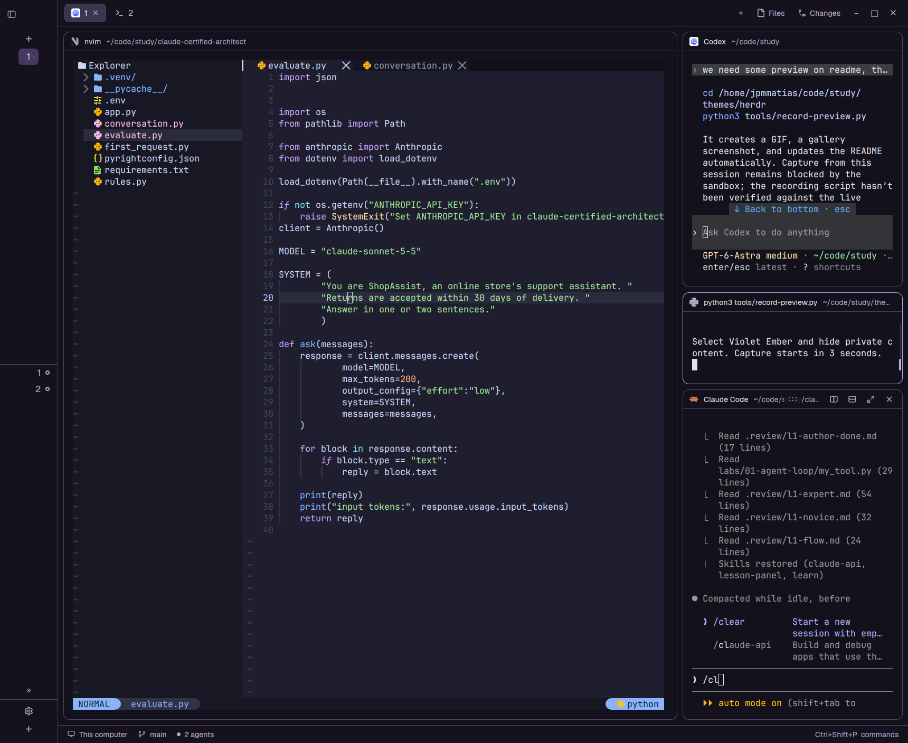

# Violet Ember

A dark Herdr desktop layout with violet surfaces, lavender focus accents,
pink primary actions and coral errors. It retains the familiar spaces sidebar,
agent list, tabs and split terminals.

`preview.png` shows Herdr running the theme; `preview.gif` contains the recorded
preview. The SVG is a separate palette illustration.

## What you see

A 268px sidebar on the left uses near-black violet chrome (`#15121E`). A 46px
brand row sits above spaces and agents, which share the available height. A
69px footer sits below them. On the right, a 42px tab strip sits above the
terminal area and a 28px status bar sits below it. The work area has 8px padding
and gaps. Terminal cards have 10px corners, 1px borders and 30px pane headers.
An optional 368px side panel hosts files and changes; it starts hidden.

Terminals use `#13111B` with `#E1E1E6` text. Hover is `#302A40`, selection is
`#46385F`, focus is lavender `#B6A4EE`, and primary actions are pink `#FF79C6`.
Fonts inherit the user's settings. The theme file defines all 16 ANSI colors.

## How it behaves

Shipped mods provide standard space, agent, tab and pane interactions. Working
uses cyan, blocked uses coral, done uses green, idle uses muted lavender, and
unknown uses yellow. There are no added animations or keyboard bindings.
Switching to this layout selects its theme; existing layouts stay available.

## Built from

`layouts/violet-ember.json` adapts Herdr's shipped main layout, adding the root
theme `violet-ember`. `themes/violet-ember.json` supplies the palette.

The root row contains sidebar and work columns. Sidebar blocks use
`workspace-chrome` (brand and footer, the latter with `footer: true`), `spaces`,
and `agents`. Work contains `tabs`, a row with the active tab and optional
files/changes stack, and `workspace-status`. Pane headers use `pane`.
All these mods ship with Herdr; none are bundled or modified here. The installed layout
adds no executable code, external programs, network requests or custom art.
The optional `tools/record-preview.py` development utility uses `herdr-app` and
FFmpeg to record previews; it is not part of the installed layout.

## Watch out

Use the Herdr desktop JSON format, not the Herdr TUI TOML format. Install both
JSON files before selecting the layout. Do not overwrite an existing layout
or theme with the same name without checking its contents. A theme sharing a
layout's name may appear in the picker only for that layout. The optional
panel requires 280px minimum width. Sidebar lists each require 90px minimum
height. User settings and theme picker changes can alter the resulting look.
VS Code syntax italics are not represented by this color theme.

## Done when

- Both JSON files parse and every referenced shipped mod exists.
- The layout opens without Herdr errors and shows spaces, agents and tabs.
- Selecting tabs, focusing agents and splitting panes work normally.
- Hovered and selected rows are visibly different; focused panes are lavender.
- ANSI errors are coral, successes green, and normal terminal text is readable.
- A real screenshot is saved as `preview.png` after live verification.

The JSON and shipped mod dependencies passed static checks. The preview was
recorded by the author in Herdr. The interaction checklist above remains the
manual release verification guide.
